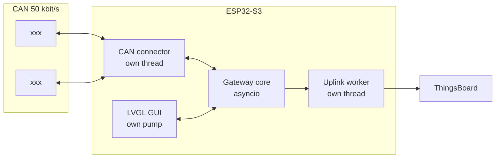

# tbgw_esp32

A port of the [ThingsBoard IoT Gateway](https://github.com/thingsboard/thingsboard-gateway)
to **MicroPython**, running on a single ESP32-S3 with a 5-inch touch panel.

It does three things the upstream gateway does not do in this combination:

- runs the gateway's connector/converter/storage architecture on a
  **microcontroller** rather than a Linux host;
- speaks a **register-oriented CAN protocol** through a declarative schema that
  generalises the upstream byte-offset model rather than replacing it;
- provides a **local LVGL touch interface** that monitors and controls the same
  devices with no cloud round trip — and keeps working when the network does not.

**Hardware:** Waveshare ESP32-S3-Touch-LCD-5 (1024×600), ESP32-S3-WROOM-1-N16R8
— 16 MB flash, 8 MB octal PSRAM. CAN on GPIO15/16 at 50 kbit/s.

---

## Status

**Working and validated on real hardware.** Development is frozen; the
remaining work is documentation and the measurement campaign.

| Capability | State |
|---|---|
| CAN events → ThingsBoard telemetry (real timestamps, scaled values) | ✅ verified on hardware |
| ThingsBoard RPC → physical relay actuation | ✅ verified on hardware |
| Register polling with read correlation | ✅ verified on hardware |
| Local GUI: monitor + control, 1024×600 | ✅ verified on hardware |
| Wi-Fi / NTP / offline operation | ✅ verified on hardware |
| Host test suite | ✅ 320 tests, no hardware required |
| Quantitative measurements | ⛔ **not performed** — hardware access ended |
| MQTT-broker connector | ⚠️ implemented but **disabled** — see below |

**Known live defect:** the MQTT-broker connector's `connect()` is a blocking
socket call on the asyncio event loop. Against an unreachable broker it stalls
the whole gateway for ~60 s per retry. It is removed from the device config;
do not enable it against a broker that may be unreachable.
(`docs/technical_report.md` §12.3.)

---

## Documentation

Start here, depending on what you want:

| Document | Read it for |
|---|---|
| **[`docs/technical_report.md`](docs/technical_report.md)** | The full story: design, alternatives, architecture diagrams, every falsified assumption, defects found in dependencies, measurement specification |
| [`docs/installation.md`](docs/installation.md) | Build firmware, flash, deploy, configure, recover |
| [`docs/measurement_guide.md`](docs/measurement_guide.md) | Executable procedure to fill in the report's measurement tables |
| [`docs/can_connector_design.md`](docs/can_connector_design.md) | The CAN schema contract and converter specification |
| [`docs/pin_map.md`](docs/pin_map.md) | Vendor-confirmed pins and panel timings |
| [`docs/architecture.md`](docs/architecture.md) | Original architecture notes and phase plan |
| [`docs/testing.md`](docs/testing.md) | Test suite coverage and conventions |
| [`docs/hardware_bringup_checklist.md`](docs/hardware_bringup_checklist.md) | Before powering on new hardware |

---

## Quick start

Run the test suite — no hardware needed:

```bash
python3 -m pytest tests/host -q      # 320 tests
```

Put it on a board: follow [`docs/installation.md`](docs/installation.md). In
outline —

```bash
./build/build_firmware.sh                    # ~30-60 min, applies both patches
# flash the produced .bin with esptool
# format the filesystem, then:
mpremote connect /dev/ttyACM0 cp -r src/tbgw :tbgw
mpremote connect /dev/ttyACM0 cp src/main.py :main.py
```

> **Check your panel variant first.** This board ships as 800×480 *and*
> 1024×600, with completely different timings. The wrong branch produces a
> permanently corrupted image that no amount of tuning fixes. The boot log
> prints the panel's own resolution.

---

## How it works



xxx

Adding a device is a configuration change, not a code change.

---

## Repository layout

```
build/     firmware recipe + patches for both vendored native modules
config/    tb_gateway.json, can.json, mqtt.json, logs.json, home_devices.json
docs/      technical report, installation, measurement guide, design docs
src/       boot.py, main.py, tbgw/  (55 modules, ~6.9 kLOC)
tests/     host/  — host-side tests
```

---

## Notes for anyone continuing this work

Three things cost the most time, and all three are documented in detail in the
technical report:

1. **The panel is 1024×600, not 800×480.** Wrong-branch timings give corruption
   that is immune to every porch/clock/polarity adjustment, which makes it look
   like anything *but* a resolution problem.

2. **A vendored C module that blocks without releasing the GIL freezes the
   entire runtime** — every thread, no traceback, power cycle only. Both
   dependencies did this. Before trusting any vendored native module:

   ```bash
   grep -n "MP_THREAD_GIL_EXIT" module.c      # expect hits
   grep -n "portMAX_DELAY\|, -1)" module.c    # expect none unguarded
   ```

3. **`mpremote run` does not reset the board.** Hard-reset before every hardware
   experiment, one variable per power cycle, or you will draw conclusions from
   contaminated state.

The patches in `build/patches/` are not optional — without them the bus appears
dead and the board hard-locks under GUI load.

---

## Licence

See [`LICENSE`](LICENSE) and [`NOTICE`](NOTICE). Derived from the ThingsBoard IoT
Gateway (Apache 2.0).
