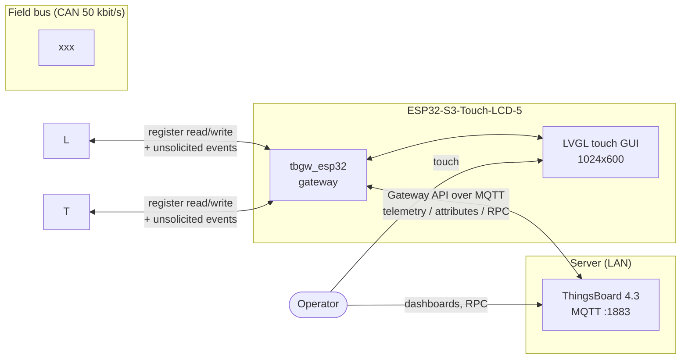
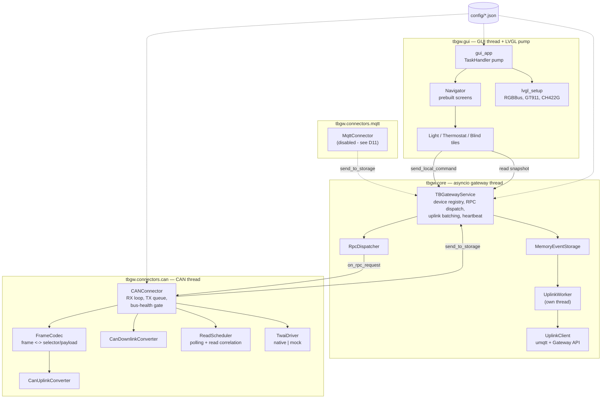
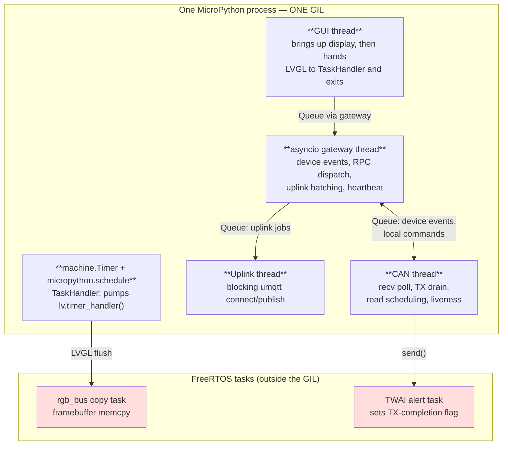
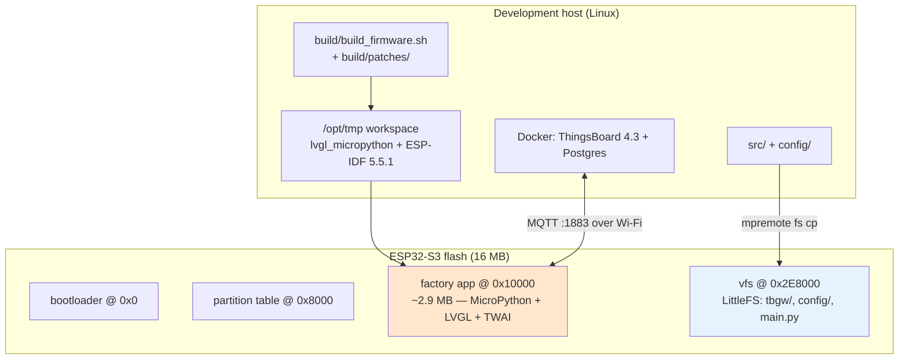
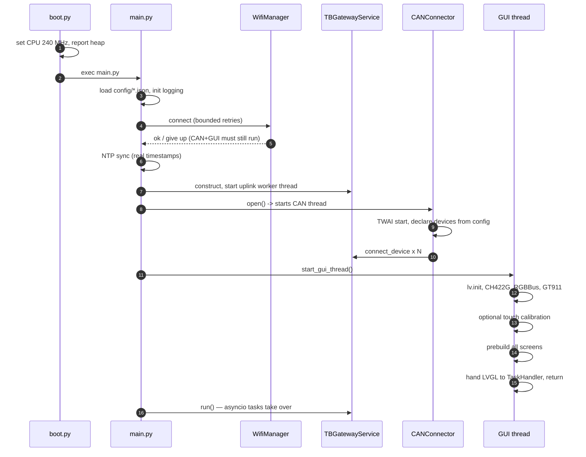
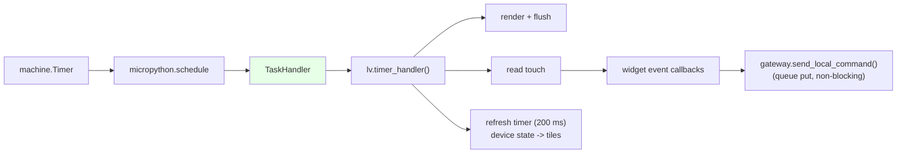
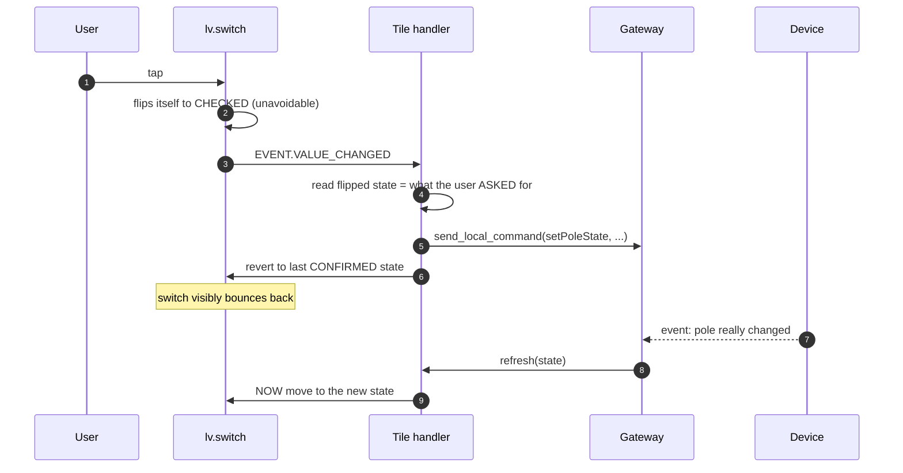
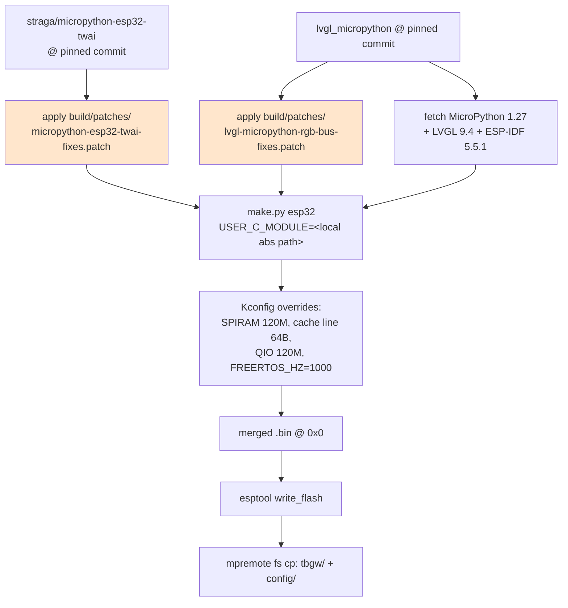
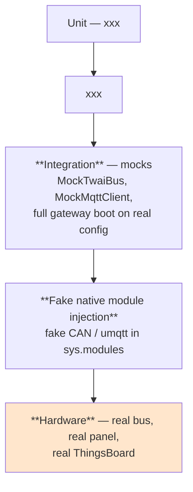
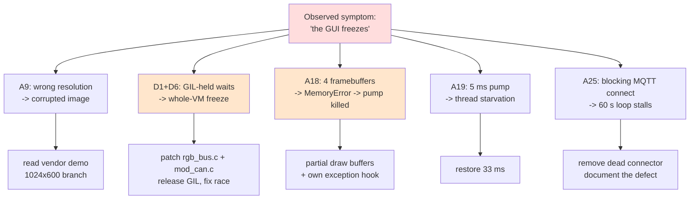

# Porting the ThingsBoard IoT Gateway to MicroPython on an ESP32-S3 with a Register-Oriented CAN Connector and a Local LVGL Interface

**A technical report**

---

## Abstract

This report documents the design, implementation and hardware bring-up of
`tbgw_esp32`: a port of the [ThingsBoard IoT Gateway](https://github.com/thingsboard/thingsboard-gateway)
— normally a CPython service running on a Linux host — to MicroPython on a
single ESP32-S3 microcontroller, extended with two capabilities the upstream
project does not provide in this form: a **register-oriented CAN connector**
able to speak a bitfield-based field-bus protocol, and a **local LVGL touch
interface** that monitors and controls the same devices without a cloud round
trip.

The work began from a machine-generated baseline (~8.8 kLOC across 89 files)
that had never been executed against real hardware. Bringing that baseline up
on a physical board invalidated a substantial fraction of its assumptions.
This report treats those invalidations as primary results rather than as
incidental defects: it catalogues **25 falsified assumptions** and **11 defects
located in third-party dependencies**, and argues that the distribution of
those defects — overwhelmingly concentrated at the Python/C boundary of
vendored native modules — is the main transferable finding of the project.

Because access to the hardware ended before a measurement campaign could be
run, all quantitative sections are presented as **specified-but-unfilled**
tables, accompanied by a separate executable procedure
(`docs/measurement_guide.md`) sufficient to populate them.

---

## Table of contents

1. [Introduction](#1-introduction)
2. [Background](#2-background)
3. [Related work](#3-related-work)
4. [Requirements](#4-requirements)
5. [Architecture](#5-architecture)
6. [The CAN connector: a register/selector model](#6-the-can-connector-a-registerselector-model)
7. [The local GUI](#7-the-local-gui)
8. [Protocol reverse engineering and data gathering](#8-protocol-reverse-engineering-and-data-gathering)
9. [Implementation and build pipeline](#9-implementation-and-build-pipeline)
10. [Verification and test strategy](#10-verification-and-test-strategy)
11. [Falsified assumptions: a catalogue](#11-falsified-assumptions-a-catalogue)
12. [Defects located in third-party dependencies](#12-defects-located-in-third-party-dependencies)
13. [Measurements](#13-measurements)
14. [Discussion](#14-discussion)
15. [Conclusion](#15-conclusion)
16. [Future work](#16-future-work)
17. [Appendices](#17-appendices)

---

## 1. Introduction

### 1.1 Context

ThingsBoard is an open-source IoT platform. Its **IoT Gateway** is a companion
service that bridges devices speaking local protocols (MQTT, Modbus, OPC-UA,
CAN, BLE, …) to the ThingsBoard server, presenting each local device as a
first-class ThingsBoard device with telemetry, attributes and RPC. The upstream
gateway is a CPython application: it assumes a filesystem, threads, a full
standard library, and megabytes of RAM.

This project asks whether that architecture can be usefully compressed onto a
single microcontroller — specifically an ESP32-S3 with 8 MB of PSRAM — while
simultaneously driving a 5-inch touch panel as a local control surface, and
while speaking a CAN field-bus protocol that does not fit the gateway's
existing CAN connector model.

### 1.2 Problem statement

Three problems compose:

**P1 — Runtime compression.** The upstream gateway's structure (connectors,
converters, an event-storage layer, an MQTT uplink client, an RPC dispatcher)
must be preserved closely enough that its configuration model and mental model
still apply, while fitting a runtime with no `logging`, no `asyncio` primitives
beyond a minimal core, no `threading`, and a garbage-collected heap shared with
a graphics stack.

**P2 — Protocol mismatch.** The upstream CAN connector models a device as
*one CAN identifier plus fixed byte offsets into the payload*. The target
field bus (a xxx building-automation bus) instead models a device as a
*node address exposing a register file*, where a single byte packs several
independent fields. The two models are not reconcilable by configuration
alone.

**P3 — Coexistence.** A graphics stack, a CAN driver and a network stack must
share one dual-core microcontroller and one Python interpreter lock without
starving each other — a constraint that, as Section 11 shows, turned out to
dominate the project's difficulty.

### 1.3 Contributions

1. A **register/selector CAN connector schema** (Section 6) that is strictly
   more general than the upstream byte-offset model, which it subsumes as a
   degenerate case, while remaining fully declarative — no protocol specifics
   in Python.
2. A **working port** of the gateway core to MicroPython, validated end-to-end
   on physical hardware: real CAN events reach a real ThingsBoard server, and
   real ThingsBoard RPCs actuate real relays.
3. A **local-control interaction model** (Section 7.3) that keeps a touch UI
   truthful about physical state without optimistic updates.
4. An empirical **catalogue of falsified assumptions** (Section 11) and
   **third-party defects** (Section 12), including patches for two vendored
   native modules.
5. A **measurement specification** (Section 13 and `docs/measurement_guide.md`)
   for the campaign that hardware access did not permit.

### 1.4 Scope and non-goals

In scope: gateway core, CAN connector, MQTT-broker connector, ThingsBoard
uplink, LVGL GUI, firmware build recipe, host-side test suite.

Explicitly **not** goals: TLS to the ThingsBoard broker; persistent (flash-backed)
event storage; OTA update; multi-home scale-out; the full upstream connector
catalogue. Section 16 revisits these.

### 1.5 A note on provenance and method

The starting point was a complete but **entirely unexecuted** codebase produced
in a prior automated session, together with its own design documents. That
baseline is treated here as a *specification-grade artifact*: plausible,
internally coherent, and — as the record shows — wrong in most places where it
touched hardware or a third-party API surface.

This distinction matters for interpreting the results. The interesting question
is not "was the generated code correct" (it was not, in the places that
mattered) but **which classes of error survive plausibility review and are only
detectable against physical hardware**. Section 14 argues the answer is sharply
skewed toward the Python↔C boundary.

---

## 2. Background

### 2.1 The ThingsBoard gateway model

The upstream gateway is organised around four abstractions, all of which this
port preserves:

| Abstraction | Role |
|---|---|
| **Connector** | Owns one local protocol (CAN, MQTT, …); discovers/serves devices |
| **Converter** | Uplink: bus bytes → telemetry/attributes. Downlink: RPC → bus bytes |
| **Storage** | Buffers converted events between connectors and the uplink |
| **Gateway service** | Owns the ThingsBoard MQTT session, device registry, RPC dispatch |

Its wire protocol to the server is the *Gateway API*: a small set of MQTT topics
(`v1/gateway/connect`, `.../telemetry`, `.../attributes`, `.../rpc`) that let one
MQTT session represent many logical devices. A gateway device is marked
`additionalInfo.gateway = true`; sub-devices are auto-provisioned by name on
first `connect`.

### 2.2 The target platform

| Property | Value |
|---|---|
| MCU | ESP32-S3 (dual Xtensa LX7 @ 240 MHz) |
| Module | ESP32-S3-WROOM-1-N16R8 |
| Flash | 16 MB, quad SPI |
| PSRAM | 8 MB, **octal** |
| Board | Waveshare ESP32-S3-Touch-LCD-5 (**1024×600** variant) |
| Panel | RGB565 parallel, 16 data lines, ST7262-class |
| Touch | GT911 (I²C) |
| IO expander | CH422G (I²C) — LCD reset, backlight, touch reset, SD CS |
| CAN | On-chip TWAI, GPIO15 TX / GPIO16 RX |

### 2.3 MicroPython and its gaps

MicroPython is not a subset of CPython so much as a re-implementation with
different failure modes. The gaps that shaped this design:

- **No `logging`.** A minimal levelled logger was written (`tbgw/utils/logger.py`).
- **No `sys.exc_info()`.** A `logging.exception()`-equivalent cannot recover the
  active exception; the exception object must be passed explicitly. This single
  gap hid several defects for hours (Section 11, A22).
- **A Global Interpreter Lock held across C calls.** `_thread` threads are real
  FreeRTOS tasks, but any C extension that blocks *without* releasing the GIL
  freezes **every** Python thread. This is the single most consequential
  property of the platform for this project (Section 12).
- **`_thread.stack_size()` is process-global**, not per-thread.
- **No thread pinning.** `_thread.start_new_thread` takes no core argument, so
  "core assignment" in this design is advisory only.

### 2.4 TWAI, the ESP32's CAN controller

TWAI (Two-Wire Automotive Interface) is Espressif's CAN 2.0 controller. Relevant
behaviours:

- A controller that accumulates transmit errors enters **BUS_OFF** and stops
  transmitting until recovered. It does not recover spontaneously unless
  configured to.
- Transmission requires **acknowledgement by at least one other node**. An
  unterminated or single-node bus therefore fails to transmit, drives the error
  counters, and reaches BUS_OFF — a failure mode that looks like a software bug
  and, in this project, twice did (Section 11, A26).

### 2.5 LVGL and RGB panel refresh

LVGL renders into *draw buffers* and calls a *flush callback* to move rendered
regions to the display. For an RGB parallel panel there is no display
controller with its own frame memory: the panel is refreshed continuously by
DMA reading a framebuffer in PSRAM. Two consequences dominate Section 11:

1. **Scanout is bandwidth-critical.** If DMA cannot read the framebuffer fast
   enough, the image visibly degrades. Espressif's recommended mitigation is a
   *bounce buffer* in internal SRAM.
2. **Draw buffers are not framebuffers.** Sizing them like framebuffers wastes
   memory proportional to screen area — which, at 1024×600×2 bytes, is 1.2 MB
   per buffer.

---

## 3. Related work

| Work | Relation | What was taken / rejected |
|---|---|---|
| `thingsboard/thingsboard-gateway` (CPython) | The thing being ported | Architecture, config model, Gateway API. Rejected: threading model, byte-offset CAN converter |
| A prior partial MicroPython port (student work, supplied as PDF) | Same goal, earlier attempt | Ideas only; not binding. Confirmed the general shape was feasible |
| `straga/micropython-esp32-twai` | Vendored: CAN for MicroPython | Used, **patched** — 3 defects found (Section 12) |
| `lvgl-micropython/lvgl_micropython` | Vendored: LVGL + display/touch drivers + build system | Used, **patched** — 2 runtime defects, 3 build defects (Section 12) |
| Espressif `esp_lvgl_port` / `esp_lcd` RGB driver | The vendor's own C-side approach | Not usable from MicroPython, but its *design* (bounce buffers, direct mode) explains our performance ceiling (Section 14.3) |
| Waveshare vendor demo (`ESP32-S3-Touch-LCD-5-Demo`) | Ground truth for board specifics | Pin map, panel timings, CH422G sequencing — **authoritative**, and the source of the decisive 1024×600 discovery |

**Positioning.** Mainline MicroPython still ships no ESP32 TWAI backend
(verified against the upstream tree up to v1.29.0: `extmod/machine_can.c` exists
but is not wired for the esp32 port). Custom firmware is therefore not a
convenience here but a precondition — and combining LVGL *and* CAN in one image
is the specific integration this project had to prove.

---

## 4. Requirements

### 4.1 Functional

| ID | Requirement | Status |
|---|---|---|
| F1 | Present each CAN device to ThingsBoard as a sub-device | Met |
| F2 | Publish telemetry/attributes with real Unix timestamps | Met |
| F3 | Accept ThingsBoard RPC and actuate the device | Met |
| F4 | Poll registers that do not report spontaneously | Met |
| F5 | Local GUI monitors and controls the same devices | Met |
| F6 | GUI reflects **physical** state, never assumed state | Met (Section 7.3) |
| F7 | Operate CAN + GUI with no network | Met |
| F8 | MQTT-broker connector for non-CAN devices | Implemented; **disabled** (Section 12, D11) |

### 4.2 Non-functional

| ID | Requirement | Status |
|---|---|---|
| N1 | Protocol specifics confined to configuration, not Python | Met — the central design constraint |
| N2 | Logic testable on a desktop without hardware | Met — 320 host tests |
| N3 | Survive bus faults without manual intervention | Met (Section 6.5) |
| N4 | A fault in one subsystem must not take down the others | **Partially met** — see Section 14.1 |
| N5 | Reproducible firmware build | Met — pinned refs + patches |

### 4.3 Constraints

- Single MCU; no companion processor.
- One Python interpreter lock shared by GUI, CAN and network threads.
- ~2.9 MB application partition (effectively full — Section 9.4).
- Field bus at 50 kbit/s; standard 11-bit identifiers.

---

## 5. Architecture

### 5.1 Alternatives considered

Three candidate architectures were evaluated before implementation.

| | **A: single asyncio loop** | **B: all-threads** | **C: asyncio core + dedicated threads** |
|---|---|---|---|
| CAN I/O | polled in the loop | own thread | **own thread** |
| GUI | pumped in the loop | own thread | **own thread** |
| Uplink MQTT | in the loop | own thread | **own thread** (added in Phase 4) |
| Blocking-call risk | any blocking call stalls everything | lock-ordering hazards everywhere | blocking confined to threads |
| Testability | high | low | high (core stays single-threaded) |
| **Verdict** | rejected — LVGL and umqtt both block | rejected — no GIL relief, worse to reason about | **selected** |

Architecture **C** was selected. The reasoning was that MicroPython's `asyncio`
gives clean sequencing for the gateway core, while the two genuinely blocking
subsystems (CAN driver, display) are isolated behind queues.

**Retrospective assessment.** The decision was correct in structure but rested
on a false premise: that a dedicated thread *isolates* blocking. Under
MicroPython's GIL it does not — a C call that blocks without releasing the GIL
freezes every thread regardless of which one made it. Architecture C survived,
but only after patching the two vendored modules to release the GIL
(Section 12). This is elaborated in Section 14.1.

### 5.2 Context view



### 5.3 Component view



### 5.4 Concurrency view

This is the view that matters most, because every serious defect in the project
lived here.



> **The critical property.** The two red boxes are FreeRTOS tasks that Python
> threads *wait on*. If a Python thread waits on one of them while holding the
> GIL, the entire process stops — no traceback, no soft-reset recovery, only a
> power cycle. Both vendored modules did exactly this (Section 12, D1 and D6).

### 5.5 Deployment view



> **Operational hazard.** The app partition is sized to fit the binary. Any
> change that grows the binary triggers an automatic partition resize, which
> *shifts the vfs offset* and destroys the filesystem. This happened twice
> during development; `docs/installation.md` documents the recovery.

### 5.6 Boot sequence



---

## 6. The CAN connector: a register/selector model

xxx

## 7. The local GUI

### 7.1 Display bring-up

`lvgl_setup.py` is the single hardware-touching module. Ordering is not
incidental — it is forced by the driver framework:

```mermaid
sequenceDiagram
    autonumber
    participant A as gui_app
    participant L as LVGL
    participant I as I2C / CH422G
    participant P as RGBBus panel
    participant T as GT911

    A->>L: lv.init()  (MUST be first)
    A->>I: CH422G.set_mode(0x01)  (IO_OE — without it every write is a no-op)
    A->>I: LCD reset held deasserted (never pulsed)
    A->>I: touch reset pulse: 100 ms assert, 200 ms settle
    A->>I: backlight OFF (avoid flash of garbage)
    A->>P: RGBBus(pins, 1024x600 timings, 21 MHz)
    A->>P: allocate PARTIAL draw buffers (100 rows)
    A->>L: RGBDisplay(...).init()  — registers as default display
    A->>T: GT911(device)  — NO display kwarg; binds to lv.display_get_default()
    A->>I: backlight ON
```

Two ordering constraints were discovered the hard way: `lv.init()` must precede
display construction, and the display must be registered *before* the input
device is constructed, because the indev binds to whatever
`lv.display_get_default()` returns and offers no way to pass a display
explicitly.

### 7.2 The single-pump rule

An earlier revision ran `while True: lv.timer_handler()` on the GUI thread.
This deadlocked silently: `indev.calibrate()` internally starts a
`task_handler.TaskHandler` (a `machine.Timer` + `micropython.schedule` pump) and
never stops it, so two pumps raced for LVGL's internal state.

The corrected design has **exactly one pump**, and the periodic device-state
refresh is an `lv.timer_create()` callback so it executes *inside* that pump:



Two rules follow, both enforced in code and comments:

- **Navigation callbacks must stay trivial.** All screens are prebuilt on the
  GUI thread; a navigation callback only calls `screen_load()`, a pointer swap.
- **No callback may raise.** An exception escaping into LVGL's C event dispatch
  leaves the input device stuck "pressed", killing touch for the rest of the
  boot. Every callback is exception-guarded.

### 7.3 The no-optimistic-update rule

The GUI must never assert a state the device has not confirmed. This is harder
than it sounds, because **`lv.switch` toggles its own visual state *before*
firing `VALUE_CHANGED`** — there is no way to intercept the tap first.



`_last_known` is written **only** by `refresh()`, i.e. only from decoded device
state. The switch therefore only ever moves forward on physical confirmation.
The visible "bounce" is deliberate: it is honest feedback that the command was
sent but not yet confirmed.

### 7.4 Layout

The first layout used hard-coded pixel offsets sized for a smaller panel. On the
real 1024×600 display this clipped the thermostat's three button rows mid-draw,
overlapped the blind's buttons, and truncated labels once a switch was
positioned over them.

The rewrite introduces `tbgw/gui/theme.py` as the single place holding sizing
and typography, and replaces absolute positioning with flex containers so
children size themselves. Touch targets are ≥ 44 px.

---

## 8. Protocol reverse engineering and data gathering

xxx

## 9. Implementation and build pipeline

### 9.1 Package layout

```
src/
  boot.py, main.py
  tbgw/
    core/        gateway_service, rpc_dispatcher, device_registry,
                 device_state_store, uplink_client, uplink_worker,
                 wifi, ntp, config_loader, constants
    connectors/
      can/       can_connector, frame_codec, read_scheduler,
                 can_uplink_converter, can_downlink_converter, twai_driver
      mqtt/      mqtt_connector (+ converters)
    gui/         gui_app, lvgl_setup, theme, ch422g, presentation,
                 device_catalog, screens/, widgets/
    storage/     memory_event_storage
    utils/       logger, queue, event, bitfield, tb_utility
```

**Scale:** 55 modules / ~6,900 lines implementation; 31 files / ~3,500 lines
tests; ~1,240 lines documentation before this report.

### 9.2 Firmware composition

Neither LVGL nor CAN exists in stock MicroPython for this target, so a combined
image is built by `lvgl_micropython`'s build system with the TWAI module
vendored as a `USER_C_MODULE`:



### 9.3 Build-time Kconfig

Prescribed by Waveshare's own performance notes for this board and independently
matched by `lvgl_micropython`'s config for a pin-identical panel:

`CONFIG_SPIRAM_SPEED_120M`, `CONFIG_SPIRAM_FETCH_INSTRUCTIONS`,
`CONFIG_SPIRAM_RODATA`, `CONFIG_ESP32S3_DATA_CACHE_LINE_64B`,
`CONFIG_ESPTOOLPY_FLASHMODE_QIO`, `CONFIG_ESPTOOLPY_FLASHFREQ_120M`,
`CONFIG_IDF_EXPERIMENTAL_FEATURES`, `CONFIG_FREERTOS_HZ=1000`,
`CONFIG_ESP_DEFAULT_CPU_FREQ_MHZ_240`, `CONFIG_COMPILER_OPTIMIZATION_PERF`.

**Honest note:** this set was adopted while pursuing a hypothesis (PSRAM
bandwidth) that turned out **not** to be the cause of the display corruption —
the resolution was (Section 11, A9). The settings are vendor-prescribed and were
retained, but they should not be credited with fixing the artifact.

### 9.4 Application partition

The binary occupies ~2.98 MB of a ~2.98 MB partition — on the last build,
**96 bytes free**. Consequences:

- Enabling additional LVGL fonts requires a partition resize.
- A resize shifts the vfs offset and **destroys the filesystem**.
- LVGL compiles in many unused optional libraries; trimming `lv_conf.h` is the
  natural way to reclaim space (Section 16).

---

## 10. Verification and test strategy

### 10.1 Layers



320 tests pass on desktop CPython with no hardware.

### 10.2 Fake-module injection

Standard mocks validate *logic* but cannot validate the **call shape** against a
native module — and that boundary is exactly where the defects clustered. The
countermeasure: inject a fake `CAN`/`umqtt` module into `sys.modules` whose
behaviour deliberately reproduces the real module's quirks (e.g. rejecting a
`bytes` argument, requiring a list). The native adapter, otherwise unreachable
on a desktop, is then exercised by the host suite.

This pattern retro-actively catches two defects that originally required
hardware to find (A5, A6).

### 10.3 What hardware testing added

| Defect class | Found by host tests? | Found on hardware? |
|---|---|---|
| Decode/encode logic | ✅ | — |
| Scheduling/correlation | ✅ | — |
| Native call shape | only after fake-module injection | ✅ |
| GIL/blocking behaviour | ❌ **structurally invisible** | ✅ |
| Panel timing/resolution | ❌ | ✅ |
| Memory exhaustion under load | ❌ | ✅ |
| Scheduling starvation | ❌ | ✅ |

The bottom four rows are the argument for hardware-in-the-loop: they are not
reachable by any desktop test of this codebase.

### 10.4 A methodological error worth recording

For a period, display experiments were run with `mpremote run script.py`
**without resetting the board between runs**. `mpremote run` does *not* reset;
it executes in the existing interpreter state. Each test therefore
re-initialised already-live display hardware on top of itself, producing hard
faults that appeared to be evidence about the parameter under test and were not.
Several conclusions had to be discarded and re-derived.

**Rule adopted:** hard-reset before every hardware experiment; one variable per
power cycle.

---

## 11. Falsified assumptions: a catalogue

Each row is an assumption that survived code review and was refuted by
execution. This table is the project's principal empirical result.

| # | Assumption | Reality | Detected by | Cost |
|---|---|---|---|---|
| A1 | xxx | xxx | xxx | xxx |
| A2 | xxx | xxx | xxx | xxx |
| A3 | The vendored TWAI API matches the assumed one | Wrong in every particular (module name, constructor, method names, argument order) | Reading real source | Driver rewrite |
| A4 | `ustruct.error` exists | Does not exist; failures raise plain `ValueError` | Hardware — crashed on **first import** | Hours |
| A5 | `CAN.send()` accepts `bytes` | Rejects it; requires a list. Asymmetric with `recv()`, which returns `bytes` | Hardware | Fake-module test added |
| A6 | umqtt accepts `password=None` | Computes `len(password)` whenever `user` is set → `TypeError` | Hardware | Fake-module test added |
| A7 | `GT911(device, display=…)` | No `display` kwarg exists; indev binds to the default display | Reading real source | Would have crashed immediately |
| A8 | CH422G outputs work after construction | `set_mode(0x01)` (IO_OE) required first; every write silently a no-op | Vendor source | Backlight/reset dead |
| A9 | **The panel is 800×480** | **It is 1024×600.** Wrong-branch timings give permanent corruption immune to every porch/clock/polarity tweak | Vendor demo + GT911 self-report | **The single largest time sink** |
| A10 | `pclk_active_low` maps directly from vendor `pclk_active_neg=1` | Empirically inverted — `True` produced a red-deficient (cyan) image | Hardware A/B | Colour fault |
| A11 | Display corruption was PSRAM bandwidth starvation | It was the resolution (A9) | Elimination | 1 firmware rebuild |
| A12 | Display corruption was a loose FPC cable | Reseating changed nothing | User test | — |
| A13 | Partial draw buffers caused the hard lock | They did not; full-screen buffers caused **memory exhaustion** (A18) | Later evidence | Wrong revert, later undone |
| A14 | LVGL v8 API names apply | Build is v9.4: `btn`→`button`, `add_btn`→`add_button`, `clear_state`→`remove_state` | Hardware tracebacks | 3 crash cycles |
| A15 | `lv.ANIM.OFF` exists | `lv_anim_enable_t` is a plain `bool` in v9; no `ANIM` enum | Hardware | Crash |
| A16 | One `while True: lv.timer_handler()` loop is fine | `calibrate()` starts a second pump that is never stopped; the two race | Hardware — silent hang | Architecture change |
| A17 | Screens can be built inside a touch callback | Deep allocation inside LVGL's C dispatch is unsafe | Hardware | Prebuilt screens |
| A18 | Two full framebuffers are affordable | The driver allocates the panel's own pair too → **four** × 1.2 MB. Free heap fell 5.4 MB → **206 KB** | Live `gc.mem_free()` | **Root cause of the GUI freeze** |
| A19 | A 5 ms LVGL pump is good | Starved every other thread; CAN polling nearly stopped | Hardware | Restored 33 ms |
| A20 | Vendor's "use a 10 ms refresh period" applies | That figure assumes ESP-IDF *direct mode*; this binding memcpy's a full 1.2 MB per flush | Reading vendor source | Reverted |
| A21 | `auto_restart=True` recovers from BUS_OFF | The module raises `NotImplementedError` | Hardware | CAN thread crashed |
| A22 | `logger.exception()` prints a traceback | It did not — MicroPython has no `sys.exc_info()`; the exception must be passed explicitly | Reading own code | **Hid several defects for hours** |
| A23 | Holding a global lock while logging is safe | Logger held a lock across sink calls → ABBA deadlock against the uplink worker | Code review | Latent freeze |
| A24 | `mpremote run` resets the board | It does not | Contradictory results | Several invalid experiments |
| A25 | The unused MQTT connector is harmless | Its blocking `connect()` to a non-existent host froze the **whole asyncio loop** for ~60 s per retry | Timestamp analysis | **Root cause of command latency** |
| A26 | A CAN fault is self-limiting | BUS_OFF + unthrottled retry logging produced **33 MB** of output, blocking the board on serial I/O | Log volume | Looked exactly like a crash |

### 11.1 The compound failure

The "GUI freeze" was never one bug. Five independent defects produced
overlapping symptoms, and each fix revealed the next — which is why single-cause
hypotheses kept appearing to fail:



The bisection that finally separated them was decisive and cheap: **stubbing out
every CAN transmit** left the freeze intact (ruling out CAN) while pure screen
navigation never froze and repeated switch taps — i.e. bursts of partial
flushes — reliably did.

---

## 12. Defects located in third-party dependencies

Eleven defects were found in vendored dependencies. Two required patching the
C sources; both patches are version-controlled in `build/patches/` and applied
by the build script.

### 12.1 `straga/micropython-esp32-twai`

| ID | Defect | Effect | Resolution |
|---|---|---|---|
| D1 | `send()` without `timeout=` takes a `portMAX_DELAY` branch **while holding the GIL** | A bus that cannot drain freezes **every** Python thread; power cycle only | Always pass a bounded timeout |
| D2 | "Initialise timing on first use" guard keyed on `brp == 0`; on ESP-IDF ≥ 5 **every** timing macro sets `brp = 0` | Requested bitrate silently ignored — the board ran at 500 kbit/s on a 50 kbit/s bus | **Patched** (guard removed) |
| D3 | Raw `char *` passed to `mp_raise_*` | Build failure against MicroPython 1.27 | **Patched** (`MP_ERROR_TEXT`) |
| D4 | Timeout compares elapsed **microseconds** against a **millisecond** value | Every timeout expires ~1000× early; nearly all sends report ETIMEDOUT despite being queued | **Patched** (scale to µs) |
| D5 | `restart()` spins on a completion flag with no timeout | Unbounded block during bus recovery | Avoided; bounded `deinit`+`start` used instead |
| D6 | `auto_restart=True` raises `NotImplementedError` | CAN thread crashed at startup | Recovery driven from Python |

> **D2 deserves emphasis.** It produced *exactly* the signature of a dead bus —
> no frames, no acknowledgements, error counters in the tens of thousands — and
> was initially attributed to wiring. The giveaway was that the driver printed
> **identical** timing values for every requested bitrate.

### 12.2 `lvgl_micropython`

| ID | Defect | Effect | Resolution |
|---|---|---|---|
| D7 | `rgb_bus_copy_task()` clears its swap event **after** arming the swap | Lost-wakeup race: a vsync ISR in that window has its notification wiped, and its guard prevents re-signalling → task waits forever | **Patched** (clear before arming) |
| D8 | `rgb_tx_color()` waits on that task with `-1` timeout **holding the GIL** | A display stall becomes a whole-system freeze with no traceback | **Patched** (`MP_THREAD_GIL_EXIT/ENTER`) |
| D9 | `USER_C_MODULE=<git-url>` writes a repo-root-relative `include()` into generated CMake | CMake cannot resolve it | Use a local absolute path |
| D10 | Post-build step hardcodes `~/.espressif/python_env`, ignoring `IDF_TOOLS_PATH` | Crash after a successful build | Symlink |
| D11 | `lib/lv_conf.h` redefines `LV_FONT_MONTSERRAT_*` to 0, overriding `LV_CFLAGS` | Font flags silently ignored; binary byte-identical | Edit `lv_conf.h` directly (not yet done) |

Additionally, an architectural gap rather than a bug: the driver **never sets
`bb_size`**, so it has no bounce buffer, unlike the vendor's own ESP-IDF driver.
This is the likely ceiling on achievable pixel clock (Section 14.3).

### 12.3 In this project's own code

| Defect | Effect |
|---|---|
| Blocking `connect()` on the asyncio loop (`mqtt_connector`) | ~60 s whole-gateway stalls; **still present**, connector disabled |
| Logger held a global lock across sink calls | ABBA deadlock against the uplink worker |
| `logger.exception()` did not print tracebacks | Concealed several defects |

---

## 13. Measurements

> **Status: not performed.** Hardware access ended before the measurement
> campaign. Every table below is specified but unfilled. The executable
> procedure is `docs/measurement_guide.md`; each table cites the section of that
> guide which populates it.
>
> The analysis paragraphs are written as prompts — what to look for, and what a
> given result would *mean* — so that whoever runs the campaign produces
> interpretation, not just numbers.

### 13.1 Boot timing — *guide §2*

| Phase | Target | Measured | Notes |
|---|---|---|---|
| Reset → `boot.py` | < 1 s | ☐ | |
| Wi-Fi associate | < 5 s | ☐ | |
| NTP sync | < 2 s | ☐ | |
| CAN thread → first device online | < 3 s | ☐ | |
| GUI init → first frame | < 3 s | ☐ | |
| Reset → fully operational | < 15 s | ☐ | |

*Analysis placeholder.* Identify the dominant term. Wi-Fi association is
expected to dominate; if GUI init is comparable, framebuffer allocation is the
likely cause and is a candidate for deferral. State whether the offline path
(N-requirement F7) meets its own budget with Wi-Fi absent.

### 13.2 Memory — *guide §3*

| Checkpoint | Free heap | `mem_alloc` | Notes |
|---|---|---|---|
| After `boot.py` | ☐ (~5.4 MB observed) | ☐ | |
| After gateway init | ☐ | ☐ | |
| After CAN connector | ☐ | ☐ | |
| After GUI init | ☐ (~2.4 MB observed) | ☐ | |
| Steady state, 1 h | ☐ | ☐ | |
| Steady state, 24 h | ☐ | ☐ | |

*Analysis placeholder.* The 1 h → 24 h delta is the leak test; anything
monotonic is a defect, not noise. Note that ~4.8 MB was previously consumed by
framebuffers alone (A18) — confirm the partial-buffer configuration holds and
quantify the headroom now available for LVGL's renderer.

### 13.3 Display — *guide §4*

| Metric | Reference | Measured |
|---|---|---|
| Pixel clock | 21 MHz (vendor) | ☐ |
| Frames/s, static screen | — | ☐ |
| Frames/s, switch animation | — | ☐ |
| Touch → visual response | < 100 ms | ☐ |
| Screen transition | < 200 ms | ☐ |
| Visual artifacts | none | ☐ |

*Analysis placeholder.* Waveshare quote 26 FPS average / 41 FPS interface at
21 MHz — but with a bounce buffer and ESP-IDF direct mode, neither of which this
binding implements. Report the shortfall against that figure and attribute it:
the per-flush full-framebuffer `memcpy` is the expected explanation
(Section 14.3).

### 13.4 CAN — *guide §5*

| Metric | Expected | Measured |
|---|---|---|
| Bitrate | 50 kbit/s | ☐ |
| Read round-trip (idle system) | ~4 ms | ☐ |
| Read round-trip (GUI active) | — | ☐ |
| Poll cycle completion | — | ☐ |
| `bus_error_count`, 1 h | 0 | ☐ |
| `tx_failed_count`, 1 h | 0 | ☐ |
| Events observed vs. actuations | 1:1 | ☐ |

*Analysis placeholder.* The idle-vs-active round-trip gap quantifies GUI
interference on the CAN thread and is the direct test of whether the 33 ms pump
choice (A19) is correct. A non-zero error count on a terminated, healthy bus
warrants investigation before any soak claim.

### 13.5 End-to-end latency — *guide §6*

| Path | Target | Measured |
|---|---|---|
| Physical change → GUI update | < 1 s | ☐ |
| Physical change → ThingsBoard telemetry | < 3 s | ☐ |
| GUI tap → relay actuates | < 500 ms | ☐ |
| GUI tap → GUI confirms | < 1.5 s | ☐ |
| ThingsBoard RPC → relay actuates | < 2 s | ☐ |

*Analysis placeholder.* "Tap → confirm" necessarily exceeds "tap → actuate" by
one poll/event interval; that gap is the visible cost of the no-optimistic-update
rule (Section 7.3) and should be reported as a deliberate design trade, not a
latency defect.

### 13.6 CPU utilisation — *guide §7*

| Thread | Idle | GUI active | Measured |
|---|---|---|---|
| asyncio gateway | ☐ | ☐ | |
| CAN thread | ☐ | ☐ | |
| LVGL pump | ☐ | ☐ | |
| `rgb_bus` copy task | ☐ | ☐ | |
| Uplink thread | ☐ | ☐ | |

*Analysis placeholder.* Verify the heartbeat interval matches its 30 s
configuration; a 60 s observed interval previously indicated 2× starvation and
is a cheap, sensitive proxy for scheduling health.

### 13.7 Stability soak — *guide §8*

| Metric | Target | Measured |
|---|---|---|
| Uptime without reset | ≥ 24 h | ☐ |
| Freezes | 0 | ☐ |
| Wi-Fi reconnects | — | ☐ |
| MQTT reconnects | — | ☐ |
| Dropped storage events | 0 | ☐ |
| Heap at end vs. 1 h | no downward trend | ☐ |

*Analysis placeholder.* This is the acceptance test for the whole defect
campaign of Section 11. State explicitly whether the GUI was exercised during
the soak — an idle soak does not test the flush path that produced the original
freezes.

### 13.8 Power — *guide §9*

| State | Measured |
|---|---|
| Idle, backlight on | ☐ |
| Idle, backlight off | ☐ |
| GUI interaction | ☐ |
| Peak (Wi-Fi TX + render) | ☐ |

---

## 14. Discussion

### 14.1 The GIL is the architecture

The intended concurrency design (Section 5.1) isolates blocking work in threads.
On CPython that is sound. Under MicroPython it is sound **only for Python-level
blocking**: a C extension that blocks without releasing the GIL suspends every
thread in the process.

Both vendored native modules did precisely this, in unrelated code, for
unrelated reasons (D1, D8). The resulting failure has a distinctive and
misleading signature:

- no exception, no traceback — Python never regains control;
- unaffected subsystems appear *selectively* dead depending on what each thread
  was waiting on;
- the USB peripheral eventually drops off the bus, so the board becomes
  unreachable;
- only a physical power cycle recovers it.

**Transferable rule.** When integrating any vendored C module into a threaded
MicroPython application, audit it for blocking calls before trusting it:

```
grep -n "MP_THREAD_GIL_EXIT" module.c     # expect hits
grep -n "portMAX_DELAY\|, -1)" module.c   # expect none unguarded
```

Requirement N4 ("a fault in one subsystem must not take down the others") is
therefore only *partially* met: it holds for Python-level faults, and holds for
these two native modules **because they were patched** — not by construction.

### 14.2 Plausibility is not correctness

The generated baseline was coherent, well-commented, and wrong wherever it
touched an unverified interface. The errors were not sloppy; they were
*plausible*: `display=` is a reasonable kwarg for a touch driver to accept;
`ustruct.error` is a reasonable mirror of `struct.error`; `send(bytes)` is a
reasonable API. Each survived review precisely because it looked right.

The distribution is stark. Of 26 falsified assumptions, essentially all of the
expensive ones lie at an interface with something *not in the repository* — a
vendored module, a panel, a driver's internal threading. Pure-logic code, which
the host suite covers well, was largely correct.

**Implication for method:** review effort and test investment should be weighted
toward interfaces with unverified external artifacts, not distributed evenly
over the codebase. The fake-module-injection pattern (Section 10.2) is the
cheapest instrument found here for pulling part of that boundary into desktop
testing.

### 14.3 A performance ceiling that is structural

The vendor achieves 26/41 FPS at 21 MHz using ESP-IDF **direct mode**: LVGL
renders straight into the panel's own framebuffer, obtained via
`esp_lcd_rgb_panel_get_frame_buffer()`, with no copy step.

`lvgl_micropython`'s binding does not implement direct mode. It always allocates
the panel's double framebuffer internally and runs a background task that
`memcpy`s a full 1024×600×2 (~1.2 MB) frame per flush. That copy is an
irreducible per-frame cost this port pays and the vendor does not — and it is
why the 10 ms refresh-period advice (A20) is actively harmful here, and why the
pump had to be slowed to 33 ms (A19).

Consequently the vendor's FPS figures are **not a fair target** for this
software stack. Section 13.3 should report the shortfall as a property of the
binding, not a tuning failure. Closing it means implementing direct mode or a
bounce buffer in the binding (Section 16).

### 14.4 On the value of the local-control path

Requirement F7 (operate without network) is not decorative. During development
the ThingsBoard container was repeatedly stopped, the Wi-Fi credentials were
absent, and an unreachable MQTT broker stalled the gateway for a minute at a
time (A25) — and throughout, the CAN connector and GUI continued to function.
The separation that makes this possible is that **local commands never traverse
the network**: a tap enqueues directly to the gateway core, which dispatches to
the connector. ThingsBoard is a subscriber to the resulting state change, not a
participant in the control path.

---

## 15. Conclusion

The ThingsBoard IoT Gateway's architecture transfers to a microcontroller. The
connector/converter/storage decomposition survived the port intact, and the
configuration-driven philosophy survived a protocol the upstream model cannot
express — the register/selector generalisation (Section 6) handles a
bitfield register file while subsuming the upstream byte-offset model as a
special case, keeping all protocol specifics out of Python.

The port was validated end-to-end on physical hardware: unsolicited CAN events
from real devices reach a real ThingsBoard server with correct timestamps and
correct scaling; RPCs from ThingsBoard actuate real relays; and the local touch
interface monitors and controls the same devices with no cloud round trip and no
optimistic state.

The dominant engineering cost was not the port. It was that **five independent
defects produced one indistinguishable symptom**, three of them inside vendored
native code, none of them reachable by desktop testing. The most valuable
artifacts this project leaves behind are therefore not only the running system
but the two dependency patches, the assumption catalogue of Section 11, and the
GIL audit rule of Section 14.1.

The principal limitation is that this is a **single-configuration result**: one
board, one bus, two device types, and no quantitative campaign. Section 13
specifies that campaign; it remains unexecuted.

---

## 16. Future work

**Correctness and robustness**

1. **Isolate the MQTT-broker connector** on its own thread, as Phase 4 did for
   the uplink client. Until then it must not be enabled against a broker that
   may be unreachable (Section 12.3). *Highest priority — a known live defect.*
2. **Remove the TX completion-wait** from the patched TWAI module. Queue-and-return
   is the correct semantic for a fire-and-forget CAN write; the current code
   works around an unreliable completion flag rather than removing the dependency.
3. **Persistent storage.** `MemoryEventStorage` loses buffered events on reset;
   a LittleFS-backed implementation would close requirement gap.

**Display**

4. **Implement a bounce buffer (`bb_size`) or direct mode** in the RGB binding —
   the structural fix for Section 14.3 and the precondition for approaching the
   vendor's frame rates.
5. **Enable larger fonts** by editing `lib/lv_conf.h` (`LV_CFLAGS` is
   overridden — D11). Note this forces a partition resize and a filesystem
   rebuild; sequence it with item 6.
6. **Trim `lv_conf.h`** to reclaim application-partition space (currently
   ~96 bytes free); LVGL compiles in many unused optional libraries.

**Validation**

7. **Execute `docs/measurement_guide.md`** and populate Section 13.
8. **Automate the golden-vector capture** so a protocol change can be
   re-baselined from a live bus rather than by hand.
9. **Extend fake-module injection** to the LVGL surface, pulling more of the
   Python↔C boundary into desktop testing.

**Scope**

10. Additional device profiles (the schema supports them; only configuration is
    required).
11. TLS to the ThingsBoard broker.
12. OTA update — non-trivial given the partition pressure of item 6.

---

## 17. Appendices

### A. Repository map

| Path | Contents |
|---|---|
| `src/tbgw/` | The gateway package (55 modules) |
| `config/` | `tb_gateway.json`, `can.json`, `mqtt.json`, `logs.json`, `home_devices.json`, `wifi.json` |
| `build/build_firmware.sh` | Verified firmware recipe |
| `build/patches/` | Patches for both vendored native modules |
| `tests/host/` | xxx |
| `docs/` | This report, architecture, CAN design, pin map, installation, measurement guide, testing |

### B. Configuration files

| File | Purpose | Committed? |
|---|---|---|
| `tb_gateway.json` | Server host/token, connectors, storage, GUI enable | Placeholder only |
| `can.json` | Frame profile, devices, datapoint sets, writes, polling | Yes — the CAN model lives here |
| `home_devices.json` | GUI device catalogue (homes → devices → subtype) | Yes |
| `logs.json` | Per-module log levels | Yes |
| `wifi.local.json` | Real credentials | **Never** — gitignored |

> Device-specific `tb_gateway.json` (real host and access token) and
> `wifi.local.json` exist **only on the board**. A filesystem rebuild requires
> recreating both.

### C. Pinned versions

| Component | Version / ref |
|---|---|
| `lvgl_micropython` | commit `d2d2646…` (rolling; no tagged releases) |
| MicroPython | 1.27.0 (via the above) |
| LVGL | 9.4 (via the above) |
| ESP-IDF | 5.5.1 (managed by the build system) |
| `micropython-esp32-twai` | commit `07aa36e…` + `build/patches/` |
| ThingsBoard | `tb-node:4.3.1.4` + `postgres:16` |

### D. Glossary

| Term | Meaning |
|---|---|
| **deviceKey** | xxx |
| **selector** | xxx |
| **frame profile** | xxx |
| **datapoint set** | xxx |
| **TWAI** | Espressif's CAN 2.0 controller |
| **BUS_OFF** | CAN state entered after excessive transmit errors; no transmission until recovered |
| **bounce buffer** | Small internal-SRAM staging buffer decoupling panel DMA from PSRAM latency |
| **direct mode** | LVGL rendering straight into the panel framebuffer, with no copy step |
| **GIL** | MicroPython's global interpreter lock — held across C calls unless explicitly released |

### E. Related documents

| Document | Contents |
|---|---|
| `docs/architecture.md` | Original architecture notes and phase plan |
| `docs/can_connector_design.md` | Full CAN schema contract and converter specification |
| `docs/pin_map.md` | Vendor-confirmed pin assignments and panel timings |
| `docs/installation.md` | Build, flash, deploy, configure, recover |
| `docs/measurement_guide.md` | Executable procedure for Section 13 |
| `docs/testing.md` | Test suite coverage and conventions |
| `docs/hardware_bringup_checklist.md` | Pre-power-on checklist |
